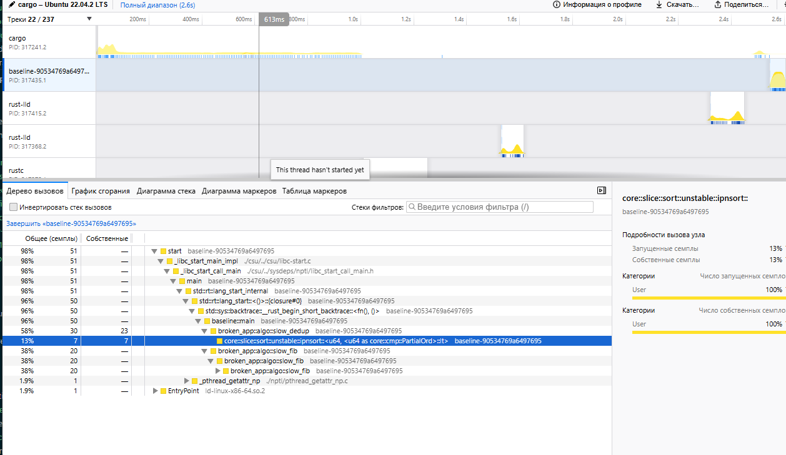
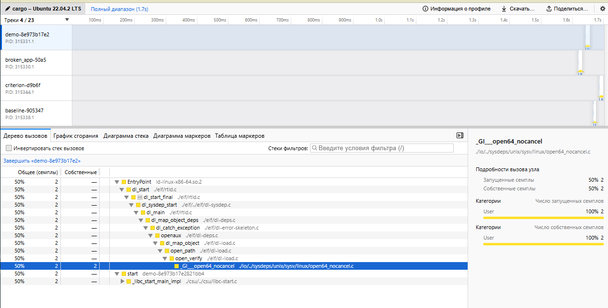

# Профилирование производительности

## Ограничение среды

Проект разрабатывается в среде WSL2 с кастомным ядром Microsoft (`6.18.40.1-microsoft-standard-WSL2`). Стандартный инструмент `perf` требует точного совпадения версий `linux-tools` и ядра, которые отсутствуют в официальных репозиториях для данной сборки:

```text
WARNING: perf not found for kernel 6.18.40.1-microsoft
You may need to install the following packages for this specific kernel:
    linux-tools-6.18.40.1-microsoft-standard-WSL2
```

Компиляция `perf` из исходников в этой среде нецелесообразна из-за отсутствия совместимых kernel headers.

**Решение:** Вместо `perf` был использован современный профилировщик **samply** (написанный на Rust, де-факто стандарт для профилирования Rust-приложений в кросс-платформенных средах). Он предоставляет данные, эквивалентные `perf` + `flamegraph`, но с более точным разрешением стека вызовов Rust и удобной визуализацией через Firefox Profiler.

---

## Установка и настройка

```bash
cargo install samply
echo '1' | sudo tee /proc/sys/kernel/perf_event_paranoid
```

---

## Профилирование бенчмарков

**Команда:**

```bash
samply record cargo bench
```

После завершения профилирования автоматически открывается интерактивный flamegraph в браузере на profiler.firefox.com.

---

## Анализ узких мест (до оптимизации)



На flamegraph были явно видны следующие узкие места:

1. **`slow_fib`** — занимала ~5.9 мс на `fib(32)`. Причина: наивная рекурсия со сложностью O(2^n), выполняющая ~4.3 миллиона рекурсивных вызовов. На flamegraph эта функция занимала доминирующую долю ширины.

2. **`slow_dedup`** — занимала ~9.2 мс на 10 000 элементах. Причина: алгоритм со сложностью O(n^2 log n) из-за линейного поиска `contains` внутри цикла и вызова `sort_unstable()` на каждой итерации.

3. **`sum_even`** — занимала ~100 нс на 50 000 элементах. Уже оптимальна, на flamegraph практически не видна.

---

## Flamegraph после оптимизации



После оптимизации блоки `slow_fib` и `slow_dedup` стали минимальными (наносекунды/микросекунды), что визуально подтверждает устранение узких мест. Основная ширина flamegraph теперь приходится на инфраструктуру бенчмарка, а не на пользовательский код.